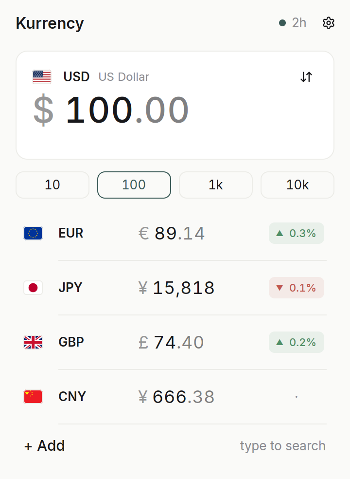
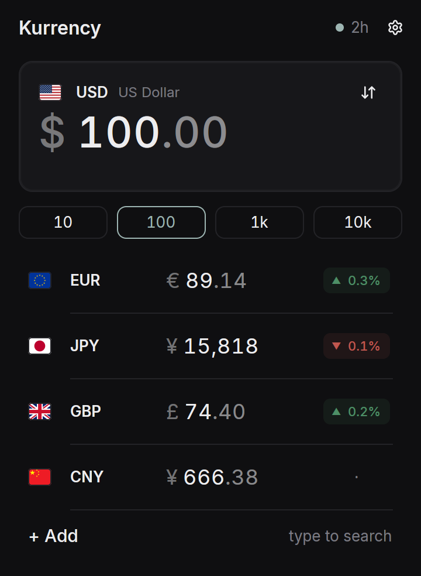
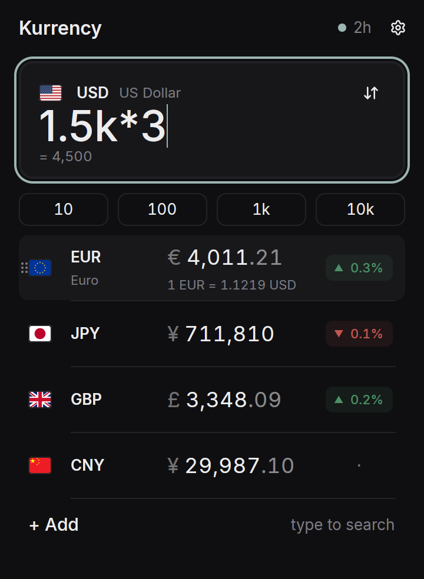
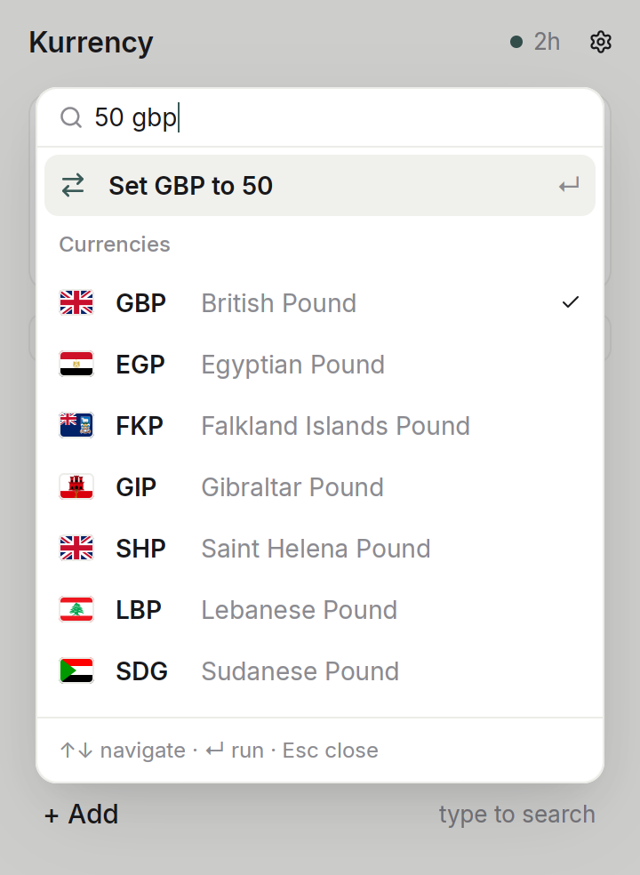
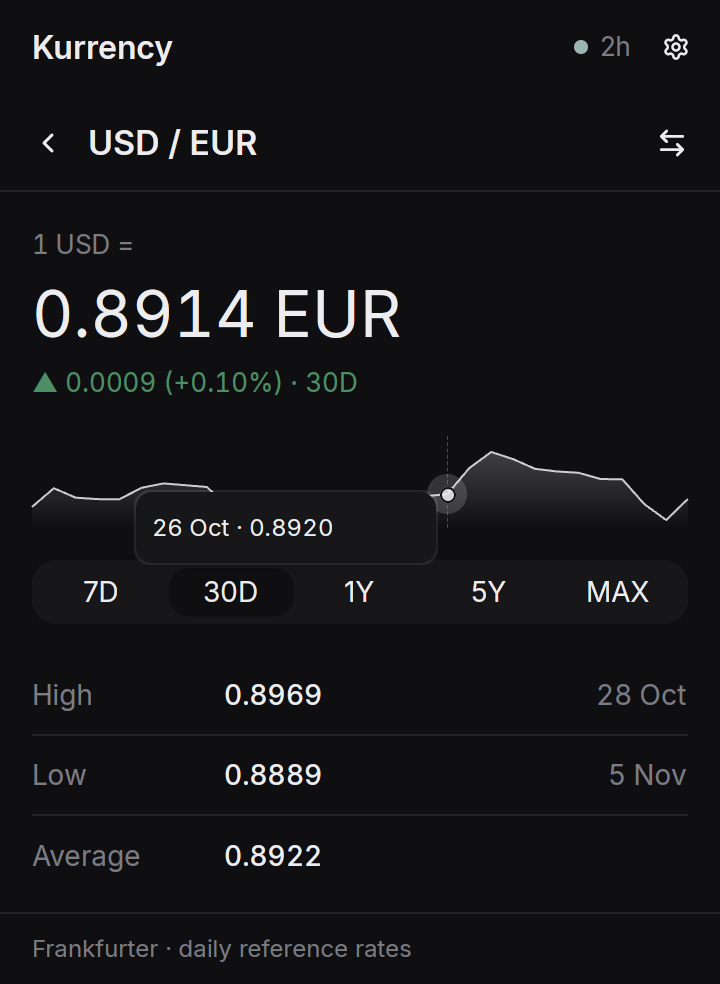
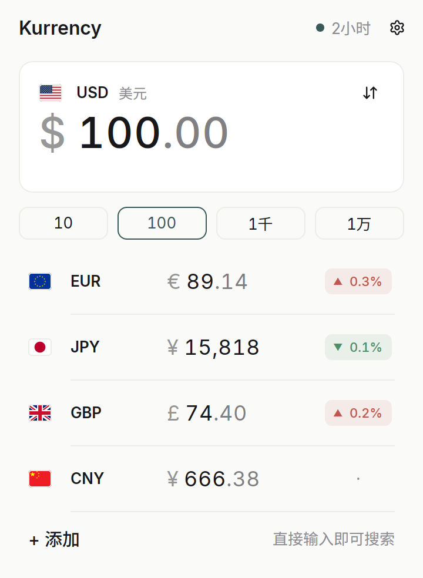
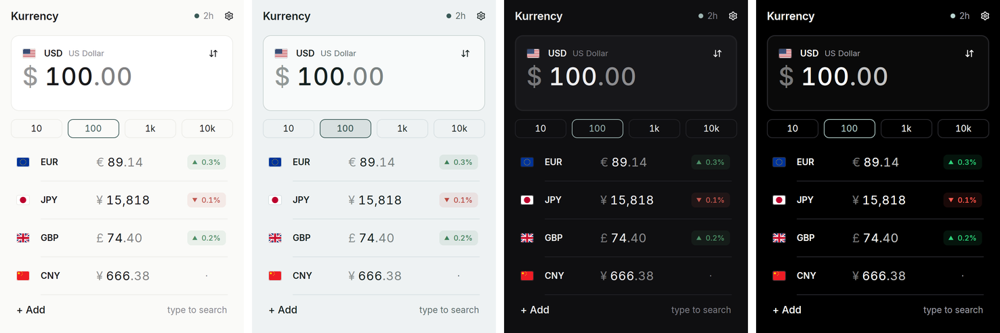

<p align="center">
  
</p>

<h1 align="center">Kurrency</h1>

<p align="center">
  A calm, beautiful currency converter for your desktop.
</p>

<p align="center">
  <a href="https://github.com/hua0512/kurrency/releases/latest"></a>
  <a href="LICENSE"></a>
  
</p>

<p align="center">
  
</p>

## Why Kurrency

- **Every currency at once.** Type an amount once and see it in all your currencies.
- **Maths built in.** Type `1.5k*3` or `(80+40)/3` and get the answer as you type.
- **Paste a price.** Copy `€45.99` or `1.234,56 kr` from anywhere and paste it in. Kurrency
  picks out the amount and the currency.
- **Rate history.** Open any currency for a chart of the last week, month, year or more.
- **Works offline.** Rates are saved on your computer, and Kurrency always tells you how
  fresh they are.
- **English and 简体中文**, with currency names in both.
- **Light and dark themes**, four of them, following your system by default.
- **Keyboard-friendly.** You never need the mouse.
- **No accounts, no API keys, no tracking.**

## A closer look

<table>
  <tr>
    <td align="center" width="50%"><br><sub>One amount, every currency</sub></td>
    <td align="center" width="50%"><br><sub>Light and dark</sub></td>
  </tr>
  <tr>
    <td align="center"><br><sub>Type <code>1.5k*3</code>; point at a row for the rate back</sub></td>
    <td align="center"><br><sub><kbd>Ctrl</kbd> <kbd>K</kbd> understands <code>50 gbp</code></sub></td>
  </tr>
  <tr>
    <td align="center"><br><sub>A month of rates, day by day</sub></td>
    <td align="center"><br><sub>简体中文</sub></td>
  </tr>
  <tr>
    <td align="center" colspan="2"><br><sub>Four themes: Paper, Slate, Graphite and Ink</sub></td>
  </tr>
</table>

## Download

Get the latest version from the [Releases page](https://github.com/hua0512/kurrency/releases/latest).

- **macOS** (11 Big Sur or later): download the `.dmg`, open it, and drag Kurrency into
  Applications. One download works on both Apple silicon and Intel Macs.
- **Windows** (10 or 11): run the `-setup.exe` installer. It needs no administrator
  rights. Prefer not to install? The `.zip` runs from any folder.
- **Linux**: download the `.AppImage`, make it executable and run it. There is also a
  `.deb` for Debian and Ubuntu, and a `.tar.gz`.

<details>
<summary><b>Using a tiling window manager?</b> Make Kurrency a small floating window.</summary>

Kurrency is designed as a compact window and sizes its own height to your list. Tiling
window managers stretch it to fill a column, so add a rule that lets it float.

Kurrency's window ID is `dev.kurrency.Kurrency` (the Wayland app ID and the X11 class), and
it is designed for about 360×560. Add a rule that opens it floating at that size. Examples:

**niri** (`~/.config/niri/config.kdl`):

```kdl
window-rule {
    match app-id=r#"^dev\.kurrency\.Kurrency$"#
    open-floating true
    default-column-width { fixed 360; }
    default-window-height { fixed 560; }
}
```

**Hyprland** (`~/.config/hypr/hyprland.conf`):

```ini
windowrule = match:class ^(dev\.kurrency\.Kurrency)$, float on, size 360 560, center on
```

Before Hyprland 0.53, use
`windowrulev2 = float, class:^(dev\.kurrency\.Kurrency)$` and matching `size 360 560` and
`center` lines.

**Sway**: `for_window [app_id="dev.kurrency.Kurrency"] floating enable, resize set 360 560`

**i3**: `for_window [class="dev\.kurrency\.Kurrency"] floating enable, resize set 360 560`

</details>

**Opening Kurrency for the first time.** Until releases are signed, your computer may
warn you about an unknown developer. On macOS, Control-click Kurrency in Applications,
choose **Open**, then **Open** again. On Windows, click **More info**, then **Run anyway**.
You only need to do this once.

## Keyboard shortcuts

On macOS, use <kbd>Cmd</kbd> where this says <kbd>Ctrl</kbd>.

| Keys | What it does |
|---|---|
| Just start typing | Change the amount, or search for a currency |
| <kbd>↑</kbd> <kbd>↓</kbd> | Move between currencies |
| <kbd>Enter</kbd> | Make the selected currency the one you type in |
| <kbd>Ctrl</kbd> <kbd>K</kbd> | Add a currency |
| <kbd>Ctrl</kbd> <kbd>V</kbd> | Paste a price |
| <kbd>Ctrl</kbd> <kbd>C</kbd> | Copy the selected amount |
| <kbd>Ctrl</kbd> <kbd>→</kbd> | Show the selected currency's history |
| <kbd>Alt</kbd> <kbd>↑</kbd> <kbd>↓</kbd> | Reorder currencies |
| <kbd>Ctrl</kbd> <kbd>Z</kbd> | Undo |
| <kbd>Ctrl</kbd> <kbd>R</kbd> | Refresh the rates |
| <kbd>Ctrl</kbd> <kbd>,</kbd> | Settings |
| <kbd>Esc</kbd> | Go back |

## Where do the rates come from?

Kurrency uses the daily reference rates that the European Central Bank and other central
banks publish, through the free [Frankfurter](https://frankfurter.dev) service. They are
mid-market rates, updated once each working day. Your bank or card will charge a little
more than this when you actually exchange money.

## Building from source

See [docs/DEVELOPMENT.md](docs/DEVELOPMENT.md).

## Credits

Kurrency is built with [GPUI](https://www.gpui.rs) and
[gpui-kit](https://github.com/longbridge/gpui-kit). It includes the
[Inter](https://github.com/rsms/inter) and [Noto Sans SC](https://github.com/notofonts/noto-cjk)
fonts (SIL Open Font License 1.1), flags from [flag-icons](https://github.com/lipis/flag-icons)
(MIT), and Chinese currency names from [Unicode CLDR](https://cldr.unicode.org) (Unicode
License v3). Exchange rates come from [Frankfurter](https://frankfurter.dev), the
[European Central Bank](https://www.ecb.europa.eu) and
[fawazahmed0/exchange-api](https://github.com/fawazahmed0/exchange-api). See [NOTICE](NOTICE)
for details.

Kurrency is free software under the [MIT licence](LICENSE).
